<p align="center">
  
</p>

<p align="center">
  
  
  
  
  
</p>

A small RAG application that writes **TypeScript for the CHILI GraFx Studio SDK** and shows its work. It ingests the SDK's public API surface (every controller method and exported type of `@chili-publish/studio-sdk` 1.48.0) into a local LanceDB vector store, retrieves the **top 5** chunks for a question, has an OpenAI model write code **using only those chunks**, and then **type-checks the code against the real npm package** of the same version. The API and the UI show every retrieved chunk with its file, line range, GitHub link and cosine score.

<p align="center">
  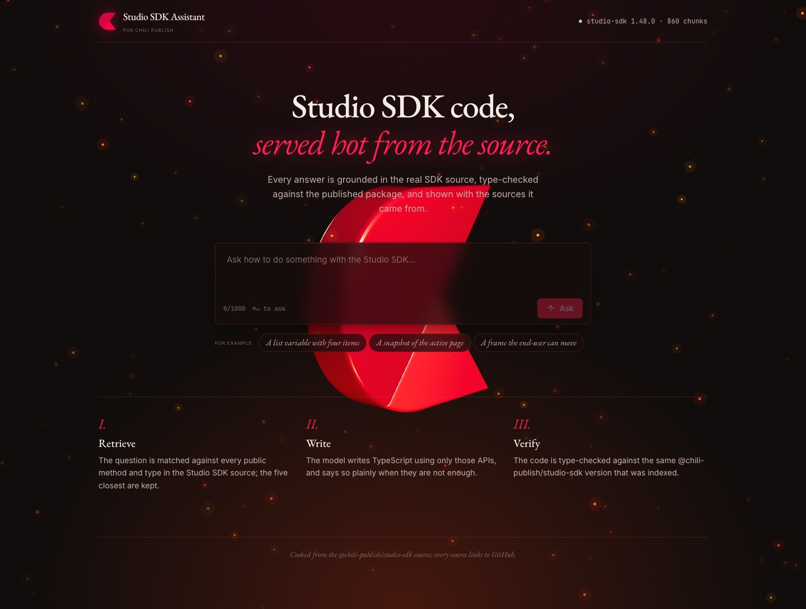
</p>

## Contents

- [At a glance](#at-a-glance)
- [Quick start](#quick-start)
- [The UI](#the-ui)
- [How it works](#how-it-works)
- [1 · Ingestion scope, and why](#1--ingestion-scope-and-why)
- [2 · Retrieval](#2--retrieval)
- [3 · Generation](#3--generation)
- [4 · Correctness: type-checking](#4--correctness-type-checking)
- [Sample questions and outputs](#sample-questions-and-outputs)
- [Evaluation](#evaluation)
- [API](#api)
- [Project structure](#project-structure)
- [Key decisions and trade-offs](#key-decisions-and-trade-offs)
- [What I would do with more time](#what-i-would-do-with-more-time)
- [How I used AI assistants](#how-i-used-ai-assistants)

## At a glance

| | |
|---|---|
| **Corpus** | `@chili-publish/studio-sdk` **1.48.0** (git tag = npm latest): `controllers/` + `types/` → **860 chunks** (447 methods, 105 interfaces, 207 type aliases, 101 enums) |
| **Chunking** | TypeScript AST (ts-morph): one chunk per public method / exported type, headed by the consumer call path, e.g. `sdk.frame.constraints.setHorizontalMovement` |
| **Vector store** | LanceDB, embedded, files in `data/`; no server, no Docker |
| **Models** | `text-embedding-3-small` for embeddings · `gpt-6.1-sol` for generation (structured JSON output) |
| **Retrieval** | exact cosine top-5 · `score = max(0, 1 − cosine distance)` |
| **Check** | every snippet compiled against `@chili-publish/studio-sdk@1.48.0` with `strict` |
| **Retrieval eval** | 16 cases · **hit@5 1.00 · MRR 0.81 · recall@5 0.94** |
| **End to end** | code generated for 14/16 eval questions · **type-check passed 14/14** · the other 2 declined instead of guessing |
| **Cost** | full ingest ≈ 59k embedding tokens (well under one cent) · a question ≈ 1k input / 100–300 output tokens |

## Quick start

**Requirements:** Node.js **24+** (current LTS), npm, git, and an OpenAI API key.

```bash
cp .env.example .env        # then set OPENAI_API_KEY
npm install
npm run ingest              # clones studio-sdk @ 1.48.0, chunks, embeds, writes data/lancedb (~10–15 s)
npm run dev                 # API on :3001 + web UI on :5173
```

Open **http://localhost:5173**, click one of the example questions, or link straight to an answer:
`http://localhost:5173/?q=I want to create a snapshot of the currently active page`

Or call the API directly:

```bash
curl -s localhost:3001/api/health
# {"status":"ok","sdkVersion":"1.48.0","model":"gpt-6.1-sol","chunks":860}

curl -s -X POST localhost:3001/api/ask \
  -H 'content-type: application/json' \
  -d '{"question":"I want to create a snapshot of the currently active page"}'
```

<details>
<summary><b>Response (real output, chunk texts shortened)</b></summary>

```json
{
  "question": "I want to create a snapshot of the currently active page",
  "answer": {
    "code": "const snapshot = await sdk.page.getSnapshot();",
    "explanation": "Omitting the page ID creates a PNG snapshot of the currently active page using default settings. The result is a Uint8Array returned directly, not wrapped in .parsedData.",
    "usedSymbols": ["PageController.getSnapshot"]
  },
  "retrieval": {
    "topK": 5,
    "chunks": [
      {
        "rank": 1,
        "score": 0.50,
        "symbol": "PageController.getSnapshot",
        "apiPath": "sdk.page.getSnapshot",
        "kind": "method",
        "file": "packages/sdk/src/controllers/PageController.ts",
        "lines": [104, 131],
        "url": "https://github.com/chili-publish/studio-sdk/blob/1.48.0/packages/sdk/src/controllers/PageController.ts#L104-L131",
        "text": "// sdk.page.getSnapshot (PageController.getSnapshot)\n/** This method returns a UInt8Array containing a PNG encoded image of the page. … */\ngetSnapshot(pageId?: Id, settings?: SnapshotSettings | null): Promise<Uint8Array<ArrayBufferLike>>"
      },
      { "rank": 2, "score": 0.42, "symbol": "LayoutController.getSelectedSnapshot", "…": "…" },
      { "rank": 3, "score": 0.37, "symbol": "PageController.select", "…": "…" },
      { "rank": 4, "score": 0.35, "symbol": "SnapshotSettings", "…": "…" },
      { "rank": 5, "score": 0.34, "symbol": "PageController.duplicate", "…": "…" }
    ]
  },
  "typecheck": { "ok": true, "errors": [] },
  "meta": {
    "model": "gpt-6.1-sol",
    "embeddingModel": "text-embedding-3-small",
    "sdkVersion": "1.48.0",
    "latencyMs": { "retrieve": 171, "generate": 3838, "typecheck": 200 },
    "tokens": { "input": 1080, "output": 67 }
  }
}
```

</details>

### Scripts

| Command | What it does | Needs the API key |
|---|---|---|
| `npm run ingest` | fetch the pinned SDK tag → chunk → embed → write LanceDB (idempotent) | yes |
| `npm run dev` | API (tsx watch) and web UI (Vite) together | yes |
| `npm start` | API only | yes |
| `npm test` | 28 unit tests (vitest), **no network** | no |
| `npm run typecheck` | `tsc --noEmit` in both workspaces (TypeScript 7) | no |
| `npm run eval` | retrieval eval: hit@5, MRR, recall@5 → `eval/results.md` | yes |
| `npm run eval:e2e` | the same plus generation and type-check pass rate | yes |
| `npm run eval:hybrid` | the hybrid-retrieval experiment → `eval/hybrid-results.md` | yes |
| `npm run samples` | sends the sample questions to the running API → `docs/samples.md` | yes |

Environment variables (see [`.env.example`](.env.example)):

| Variable | Default | Purpose |
|---|---|---|
| `OPENAI_API_KEY` | (required) | embeddings and code generation |
| `EMBEDDING_MODEL` | `text-embedding-3-small` | must be the same model at ingest and query time |
| `CHAT_MODEL` | `gpt-6.1-sol` | any OpenAI model with JSON-schema output |
| `PORT` | `3001` | API port; the Vite dev server proxies `/api` to it |

## The UI

<p align="center">
  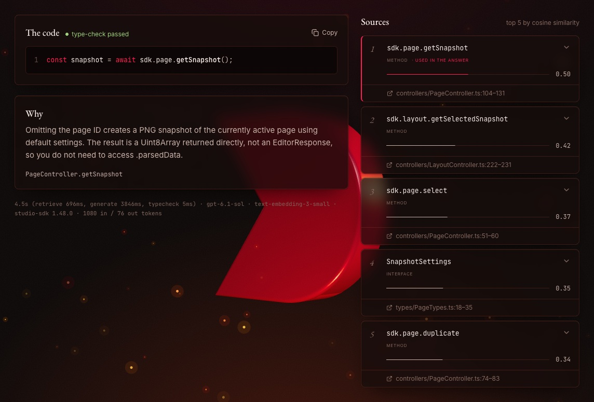
</p>

Each answer shows **the code** (syntax-highlighted, with a copy button) and a **type-check badge**, then **why** (the model's explanation and the symbols it says it used). The **sources** column lists all five retrieved chunks with their cosine-similarity bar and score, and a `file:lines` link pinned to the GitHub tag. A source the answer actually used gets a red edge.

<table>
  <tr>
    <td width="42%" valign="top">
      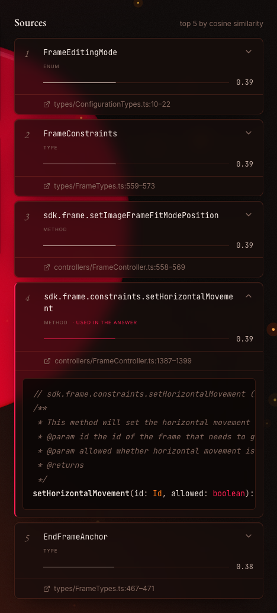
      <p><b>Retrieval transparency.</b> Expanding a source shows the exact chunk text the model received.</p>
    </td>
    <td width="58%" valign="top">
      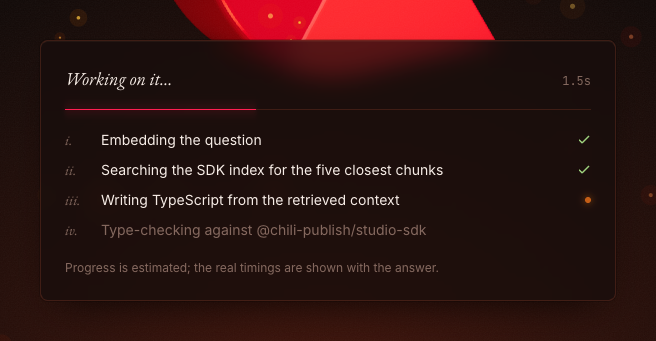
      <p><b>Progress.</b> The API does not stream, so the four stages are an honest <i>estimate</i>, labelled as such; the real per-stage timings are shown with every answer.</p>
      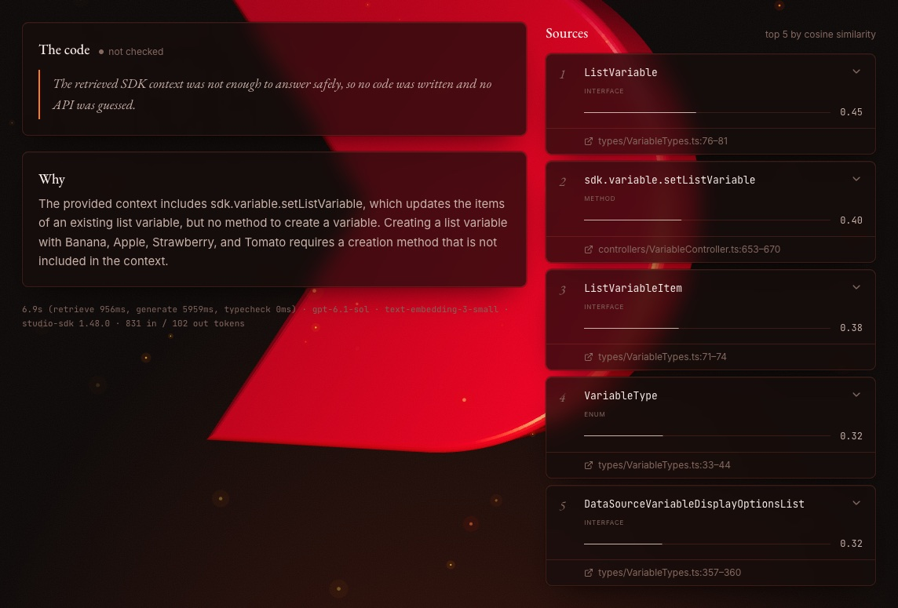
      <p><b>Declining honestly.</b> When the five chunks do not contain the APIs needed, the model says so, and the UI shows that instead of invented code.</p>
    </td>
  </tr>
</table>

<details>
<summary><b>Mobile (390 px)</b></summary>
<p align="center">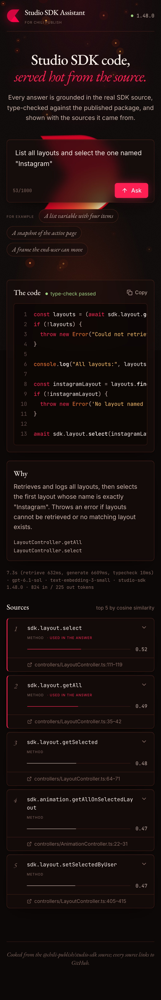</p>
</details>

**Design.** It follows the CHILI publish brand: charcoal, the brand red `#ff0048`, ember orange and a touch of gold. In the background, the CHILI publish mark (traced from the logo into an extruded, bevelled three.js model) turns once every 40 seconds above drifting embers and the occasional spark.

**Engineering choices behind the UI:**
- **Loading:** three.js is lazy-loaded so it never delays the first paint.
- **Accessibility:** every animation respects the OS "reduce motion" setting, and progress and errors are announced to screen readers.
- **Layout:** works down to phone width.
- **Stack:** React 19, Vite 8, Tailwind CSS 4, Motion, prism-react-renderer and three.js. A plain UI came first; the designed one was built only *after* the pipeline was finished and measured. The brief puts correctness and transparency first, and so did the order of work.

## How it works

<p align="center">
  
</p>

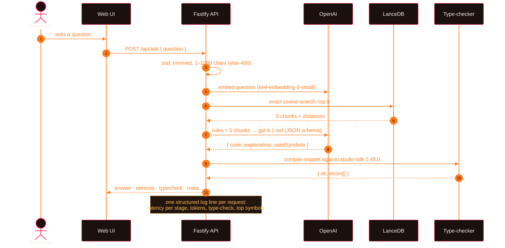

## 1 · Ingestion scope, and why

**What is in:** `packages/sdk/src/controllers/*.ts` and `packages/sdk/src/types/*.ts` (plus the public enums in `utils/Enums.ts`) of `chili-publish/studio-sdk` at git tag **1.48.0**. That is 69 files and about 12k lines, giving 860 chunks.

**Why this subset:**
- **The controllers *are* the API surface** a code assistant has to call correctly. A consumer writes `sdk.variable.create(...)`, `sdk.page.getSnapshot(...)` and so on; each of those is a controller method, documented by its own JSDoc and exact signature. That is the most precise documentation that exists.
- **The types complete the signatures:** enums such as `VariableType`, and parameter and return shapes such as `SnapshotSettings` and `FrameConstraints`.
- **One pinned version on both sides.** The tag `1.48.0` matches the latest npm release, and the type-checker uses that same npm version. The retrieved docs and the checker therefore describe the same API.

**What is deliberately out, and why:**

| Excluded | Reason |
|---|---|
| `src/next/` | an experimental API that **reuses method names with different signatures** (e.g. `next.variable.setListVariable(id, ListVariableItem[])`); it would mislead retrieval and the type-checker |
| tests, build config, generated bundles, changelog | not API documentation |
| `utils/` (except the public enums), `connectors/`, `actions/` packages | internal helpers and separate products |
| `SubscriberController`, `AdvancedUndoManagerController`, `ConnectorConfigurator` | not reachable by a consumer (private fields or internal helpers) |
| the website guides | out of the timebox; first on the "more time" list |

**Known gaps from this choice:**
- `InfoController` has only value fields (no methods), so it produces no chunks.
- The `EngineEvent` helper class (`registerCallback`) lives in `utils/`, so the model can see `config.events.onVariableListChanged` but not how to subscribe to it. The eval shows exactly this miss (see [Evaluation](#evaluation)).

### Chunking: the SDK's own structure, not text windows

<p align="center">
  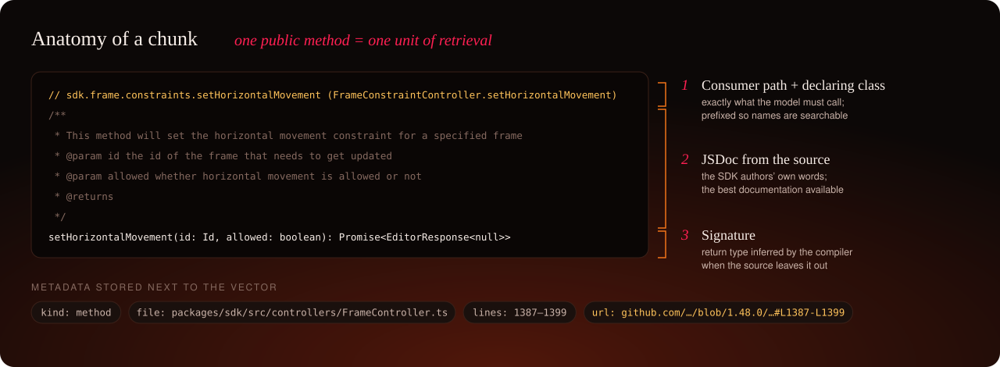
</p>

The chunker ([`server/src/ingest/chunk.ts`](server/src/ingest/chunk.ts)) uses the TypeScript AST via ts-morph. Fixed-size text windows would cut signatures in half and give scores no clear meaning; **a method is the unit the model must call correctly**, so it is the unit of retrieval. Things I verified against the real source before writing the chunker:

- **Methods are arrow-function properties** (`create = async (parentId, type) => {…}`), not method declarations, so the chunker walks `PropertyDeclaration`s with an arrow initializer (and plain methods, for safety).
- **Some controllers are nested.** `sdk.frame.constraints` is a `FrameConstraintController`, and `sdk.variable.number` a `NumberVariable`. Access paths are resolved from the `SDK` class's public `Instrumented<XController>` fields and followed into nested controllers. Every method chunk is headed with the exact path a consumer types, which also makes names searchable.
- **Private members are marked in two ways** in this SDK: `#private` fields and the `@ignore` JSDoc tag. Both are skipped, as are `private` members and constructors.
- **Return types are inferred.** Most methods don't annotate one, so the chunker loads the SDK's own `tsconfig` and asks the compiler. A chunk then says `getSnapshot(…): Promise<Uint8Array<…>>` instead of nothing. That is how the model knew `getSnapshot` returns bytes directly rather than an `EditorResponse`.

Each chunk stores `id`, `symbol`, `apiPath`, `kind`, `file`, `startLine`/`endLine` (from the start of the JSDoc) and a GitHub `url` pinned to the tag. Ingest is idempotent: the table is recreated on every run.

## 2 · Retrieval

- The question is embedded with the **same model as the index** (`text-embedding-3-small`).
- LanceDB runs an **exact** (brute-force) cosine search. With 860 rows a scan takes milliseconds, so an approximate index would add recall loss for no gain.
- **Score:** LanceDB returns cosine *distance* `d = 1 − cos θ` in [0, 2]. The API reports `score = max(0, 1 − d)`, which is plain cosine similarity clipped to [0, 1]. I deliberately did **not** rescale with `(1 + cos)/2`: that would show an unrelated chunk as 0.5 and make weak matches look strong.
- `TOP_K = 5` lives in [`server/src/config.ts`](server/src/config.ts); a unit test checks exactly 5 results, ranked, with correct scores, on a real LanceDB table built from fixture vectors (no network).

## 3 · Generation

The prompt is a version-controlled file, [`server/prompts/generate-code.md`](server/prompts/generate-code.md):

- **The snippet contract.** The code runs inside an `async` function where an initialized `sdk` (the default export class `StudioSDK`, the name the SDK's own README uses) already exists. Enum and type imports go on the first lines, and most results are read from `.parsedData`.
- **The rules.** Use **only** methods and types from the context, call them by their full `sdk.` path, and match signatures exactly. If a value is missing, fetch it with an API from the context or declare a `// TODO` constant. **If the context is not enough, say so and return no code.**
- **The response format.** The call uses the OpenAI Responses API with a zod schema (`{ code, explanation, usedSymbols }`), so the reply is validated JSON, never markdown to parse.
- **The model.** I tested six models the key could use with a real structured-output call and chose the newest, `gpt-6.1-sol`. It is a reasoning model, which matters for code; it **does not accept `temperature`**, so the plan's "low temperature" is not possible with it. `CHAT_MODEL` switches the model without code changes.

## 4 · Correctness: type-checking

[`server/src/check/typecheck.ts`](server/src/check/typecheck.ts) compiles every generated snippet against the installed `@chili-publish/studio-sdk@1.48.0`:

```ts
import { VariableType } from '@chili-publish/studio-sdk';   // the snippet's own imports, moved to the top
import type __StudioSDK from '@chili-publish/studio-sdk';   // the contract preamble
declare const sdk: __StudioSDK;
export async function __snippet(): Promise<void> {
  /* …the rest of the snippet… */
}
```

- It compiles in memory with `strict` and `noEmit`.
- Errors come back as `{ line, message }`, with line numbers mapped to the snippet the user sees.
- One ts-morph `Project` lives for the whole process, so after the first check (~200 ms) a check takes about 15–30 ms.
- **TypeScript 7 has no stable in-process compiler API** (it is the native Go port), so the project itself type-checks with TS 7 while the checker uses the TS 6 API that ts-morph bundles.
- Unit tests cover a correct snippet, a non-existent method (`getSnapshott`, reported on the right line), a wrong argument type, and an import the SDK doesn't export.

**What it proves, and what it doesn't.** A passing check proves the snippet calls methods that **exist**, with **correctly typed** arguments, against the **same SDK version** that was indexed. It does *not* prove the code does what the user meant: picking a real but wrong method still compiles. That needs a behaviour-level eval (see [more time](#what-i-would-do-with-more-time)).

## Sample questions and outputs

All outputs below are **unedited**, recorded by `npm run samples` against the running API. Full answers, with the five retrieved chunks and the timing for each, are in [**docs/samples.md**](docs/samples.md). LLM answers vary between runs: during development, the frame question returned once with code and once without.

### 1 · "I want to create a list variable with 4 items: Banana, Apple, Strawberry and Tomato" *(required)*

**Result: no code (declined).** Type-check: not run.

> The provided context does not include a method to create a variable, so I cannot provide a complete snippet to create the list variable. VariableController.setListVariable can set the items to ["Banana", "Apple", "Strawberry", "Tomato"] on an existing list variable, but it requires that variable's ID.

| # | Score | Retrieved | Source |
|---|---|---|---|
| 1 | 0.45 | `ListVariable` (interface) | [types/VariableTypes.ts:76-81](https://github.com/chili-publish/studio-sdk/blob/1.48.0/packages/sdk/src/types/VariableTypes.ts#L76-L81) |
| 2 | 0.40 | `sdk.variable.setListVariable` | [controllers/VariableController.ts:653-670](https://github.com/chili-publish/studio-sdk/blob/1.48.0/packages/sdk/src/controllers/VariableController.ts#L653-L670) |
| 3 | 0.38 | `ListVariableItem` (interface) | [types/VariableTypes.ts:71-74](https://github.com/chili-publish/studio-sdk/blob/1.48.0/packages/sdk/src/types/VariableTypes.ts#L71-L74) |
| 4 | 0.32 | `VariableType` (enum) | [types/VariableTypes.ts:33-44](https://github.com/chili-publish/studio-sdk/blob/1.48.0/packages/sdk/src/types/VariableTypes.ts#L33-L44) |
| 5 | 0.32 | `DataSourceVariableDisplayOptionsList` | [types/VariableTypes.ts:357-360](https://github.com/chili-publish/studio-sdk/blob/1.48.0/packages/sdk/src/types/VariableTypes.ts#L357-L360) |

**Why it fails.** The full answer needs two methods: `sdk.variable.create(parentId, VariableType.list)` and then `sdk.variable.setListVariable(id, items)`. Retrieval found the second but not `create`. The model then did the right thing under its rules: it did not invent the missing call. For reference, a correct snippet, which passes this project's type-check, is:

```ts
import { VariableType } from '@chili-publish/studio-sdk';

const id = (await sdk.variable.create('', VariableType.list)).parsedData;
if (id) await sdk.variable.setListVariable(id, ['Banana', 'Apple', 'Strawberry', 'Tomato']);
```

(The `''` parent id for a top-level variable is taken from the SDK's own example document, where root variables have `"parentId": ""`.)

### 2 · "I want to create a snapshot of the currently active page" *(required)*

**Result: code, type-check passed ✅**

```ts
const snapshot = await sdk.page.getSnapshot();
```

> Omitting the page ID creates a PNG snapshot of the currently active page using default settings. The result is a Uint8Array returned directly, not wrapped in .parsedData.

| # | Score | Retrieved | Source |
|---|---|---|---|
| 1 | 0.50 | `sdk.page.getSnapshot` ✔ used | [controllers/PageController.ts:104-131](https://github.com/chili-publish/studio-sdk/blob/1.48.0/packages/sdk/src/controllers/PageController.ts#L104-L131) |
| 2 | 0.42 | `sdk.layout.getSelectedSnapshot` | [controllers/LayoutController.ts:222-231](https://github.com/chili-publish/studio-sdk/blob/1.48.0/packages/sdk/src/controllers/LayoutController.ts#L222-L231) |
| 3 | 0.37 | `sdk.page.select` | [controllers/PageController.ts:51-60](https://github.com/chili-publish/studio-sdk/blob/1.48.0/packages/sdk/src/controllers/PageController.ts#L51-L60) |
| 4 | 0.35 | `SnapshotSettings` (interface) | [types/PageTypes.ts:18-35](https://github.com/chili-publish/studio-sdk/blob/1.48.0/packages/sdk/src/types/PageTypes.ts#L18-L35) |
| 5 | 0.34 | `sdk.page.duplicate` | [controllers/PageController.ts:74-83](https://github.com/chili-publish/studio-sdk/blob/1.48.0/packages/sdk/src/controllers/PageController.ts#L74-L83) |

The model also noticed, from the compiler-inferred return type in the chunk, that `getSnapshot` returns the PNG bytes directly instead of an `EditorResponse`.

### 3 · "How can I make sure that my end-user can change the position of a frame?" *(required)*

**Result: code, type-check passed ✅, but only half the answer ⚠️**

```ts
const frameId = "YOUR_FRAME_ID"; // TODO: Replace with the ID of the frame your end-user should move.

await sdk.frame.constraints.setHorizontalMovement(frameId, true);
```

> This allows the end-user to change the frame's horizontal position when the editor uses FrameEditingMode.followConstraints. It assumes the frame is selectable. The supplied context does not include methods to enable vertical movement or configure the editing mode, so this alone does not guarantee movement in both directions.

| # | Score | Retrieved | Source |
|---|---|---|---|
| 1 | 0.39 | `FrameEditingMode` (enum) | [types/ConfigurationTypes.ts:10-22](https://github.com/chili-publish/studio-sdk/blob/1.48.0/packages/sdk/src/types/ConfigurationTypes.ts#L10-L22) |
| 2 | 0.39 | `FrameConstraints` (type) | [types/FrameTypes.ts:559-573](https://github.com/chili-publish/studio-sdk/blob/1.48.0/packages/sdk/src/types/FrameTypes.ts#L559-L573) |
| 3 | 0.39 | `sdk.frame.setImageFrameFitModePosition` | [controllers/FrameController.ts:558-569](https://github.com/chili-publish/studio-sdk/blob/1.48.0/packages/sdk/src/controllers/FrameController.ts#L558-L569) |
| 4 | 0.39 | `sdk.frame.constraints.setHorizontalMovement` ✔ used | [controllers/FrameController.ts:1387-1399](https://github.com/chili-publish/studio-sdk/blob/1.48.0/packages/sdk/src/controllers/FrameController.ts#L1387-L1399) |
| 5 | 0.38 | `EndFrameAnchor` (type) | [types/FrameTypes.ts:467-471](https://github.com/chili-publish/studio-sdk/blob/1.48.0/packages/sdk/src/types/FrameTypes.ts#L467-L471) |

**Why it is incomplete.** The full answer also needs `sdk.frame.constraints.setVerticalMovement(frameId, true)`, which was not in the top 5. The model said so explicitly instead of guessing.

### My own questions

| # | Question | Result |
|---|---|---|
| 4 | How do I change the text content of a text frame? | ✅ code · type-check passed |
| 5 | List all layouts and select the one named "Instagram" | ✅ code · type-check passed |
| 6 | Find the frame named "Logo" and set its width to 200 | ❌ declined: `getByName` not retrieved |
| 7 | How can I get notified when the variables in the document change? | ❌ declined: `registerCallback` is outside the ingested subset |

<details open>
<summary><b>4 · Change the text content of a text frame</b> (type-check passed)</summary>

```ts
const textFrameId = "YOUR_TEXT_FRAME_ID"; // TODO: Replace with the target text frame's ID.
await sdk.experiment.setText(textFrameId, "Your new text content");
```
</details>

<details open>
<summary><b>5 · List all layouts and select "Instagram"</b> (type-check passed)</summary>

```ts
const layouts = (await sdk.layout.getAll()).parsedData;
console.log(layouts);

const instagramLayout = layouts?.find(layout => layout.name === "Instagram");
if (!instagramLayout) {
  throw new Error('No layout named "Instagram" was found.');
}

await sdk.layout.select(instagramLayout.id);
```
</details>

<details>
<summary><b>6 · Find the frame "Logo", set width 200</b> (declined)</summary>

> The context provides sdk.frame.setWidth, but no method to list frames or find a frame by name. Finding the frame named "Logo" requires additional SDK context; once its ID is available, its width can be set to "200" (pixels).

All five retrieved chunks were width-related (`setWidth`, `setAutoGrowMinWidth`, …). The eval question *"Find a frame **by its name** and change its width to 200"* does retrieve `getByName` at rank 1, so retrieval is also sensitive to phrasing.
</details>

<details>
<summary><b>7 · Get notified when variables change</b> (declined)</summary>

> The provided context exposes `ManagedCallbacksConfigType.events.onVariableListChanged`, whose callback receives the updated `Variable[]` list. However, it does not include a method for registering event listeners, so I cannot provide a working subscription snippet without guessing an SDK API.

The real call is `sdk.config.events.onVariableListChanged.registerCallback(…)`, and `registerCallback` lives in `utils/EngineEvent.ts`, outside the ingested subset. This is a scope gap, not a retrieval or model failure.
</details>

**What the samples show:** whenever the model wrote code, it compiled against the real SDK (4/4 here, 14/14 in the eval), and it never invented an API. Every miss is a **question with two parts** (create + set items, horizontal + vertical, find + resize), where one question embedding lands on the dominant part, or a **scope** gap. The natural next step is in [more time](#what-i-would-do-with-more-time).

## Evaluation

[`eval/retrieval-cases.json`](eval/retrieval-cases.json) has **16 questions** (the 3 required + 13 of my own), each with the **expected symbols taken from the real source**. The runner refuses to start if an expected symbol doesn't exist in the chunk set, which guards against typos. Metrics:

- **hit@5:** any expected symbol in the top 5.
- **MRR:** the mean of 1 / (rank of the first expected symbol).
- **recall@5:** the fraction of expected symbols retrieved. This is the one that matters for two-part questions; hit@5 alone would score them as perfect.

| Metric | Value |
|---|---|
| hit@5 | **1.00** |
| MRR | **0.81** |
| recall@5 | **0.94** (14/16 cases with every expected symbol retrieved) |
| end to end: code generated | 14/16 |
| end to end: type-check passed | **14/14** of generated |

The two incomplete cases are the two required questions above; the per-case table is in [`eval/results.md`](eval/results.md).

### A change the eval rejected: hybrid search

The two misses look like a textbook case for adding keyword search, since "create a list variable" shares words with `sdk.variable.create`. So I tested it before building it ([`server/src/eval/hybrid-experiment.ts`](server/src/eval/hybrid-experiment.ts), `npm run eval:hybrid`):
- **Keyword side:** BM25 using LanceDB's full-text index, with English stemming and stop words removed.
- **Fusion:** Reciprocal Rank Fusion (k = 60, top 20 from each list).
- **Variants:** five, from four ways of building the keyword field plus a half-weight keyword list.
- **Setup:** a temporary copy of the index, the same 16 cases.

<p align="center">
  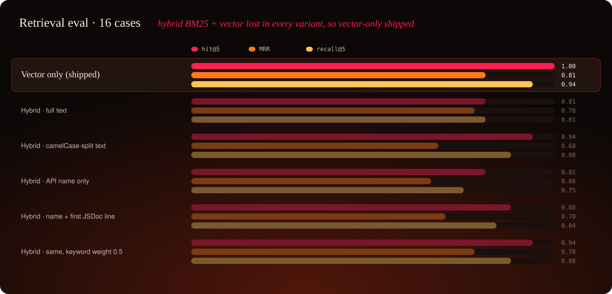
</p>

**Every hybrid variant was worse on every metric.** Words like *create*, *variable*, *frame* and *page* appear in dozens of method names and docs, so BM25 rewards the wrong matches and pushes correct vector results out of the top 5. Even `setHorizontalMovement` dropped out. The rule was "keep only if recall goes up and MRR does not drop", so **retrieval stays vector-only**. The script and the numbers stay in the repo so the decision can be reproduced ([`eval/hybrid-results.md`](eval/hybrid-results.md)).

**Limits of this eval:** 16 cases and one run each. That is directional, not statistically solid; generation in particular varies between runs.

## API

### `POST /api/ask`

Request: `{ "question": string }`. The question is trimmed and must be 1–1000 characters; otherwise the response is `400` with zod's field errors and the pipeline is not called.

Response fields:

| Field | Content |
|---|---|
| `answer` | `{ code, explanation, usedSymbols }`; `code` is `""` when the model declines |
| `retrieval` | `{ topK: 5, chunks: [{ rank, score, symbol, apiPath?, kind, file, lines: [start, end], url, text }] }` |
| `typecheck` | `{ ok, errors: [{ line, message }] }`, or `null` when no code was generated |
| `meta` | `model`, `embeddingModel`, `sdkVersion`, `latencyMs: { retrieve, generate, typecheck }`, `tokens: { input, output }` |

### `GET /api/health`

`200 { status: "ok", sdkVersion, model, chunks }` once the index is loaded. If `npm run ingest` hasn't been run, it returns `503` with a hint.

### Logging

Every answered request writes one structured JSON line (pino, through Fastify), for example:

```json
{"level":30,"reqId":"req-3","event":"ask","model":"gpt-6.1-sol","latencyMs":{"retrieve":166,"generate":7389,"typecheck":33},"tokens":{"input":965,"output":213},"typecheck":{"ok":true,"errors":0},"topSymbols":["FrameEditingMode","FrameConstraints","FrameController.setImageFrameFitModePosition","FrameConstraintController.setHorizontalMovement","EndFrameAnchor"],"msg":"answered question"}
```

## Project structure

```
.
├─ .env.example                 every variable, explained, no values
├─ server/                      Fastify API + ingest + eval (TypeScript, strict)
│  ├─ prompts/generate-code.md  the versioned prompt
│  ├─ src/
│  │  ├─ config.ts              env, models, TOP_K = 5, SDK_VERSION = 1.48.0
│  │  ├─ ingest/
│  │  │  ├─ fetch-sdk.ts        shallow clone of the pinned tag into data/ (idempotent)
│  │  │  ├─ chunk.ts            ts-morph AST chunker → 860 chunks
│  │  │  └─ index.ts            npm run ingest: fetch → chunk → embed → store
│  │  ├─ embed.ts               OpenAI embeddings, batches of 100
│  │  ├─ store.ts               LanceDB write / exact cosine search / count
│  │  ├─ retrieve.ts            top 5 + distance → score
│  │  ├─ generate.ts            prompt + Responses API with a zod schema
│  │  ├─ check/typecheck.ts     compile the snippet against @chili-publish/studio-sdk
│  │  ├─ ask.ts                 retrieve → generate → type-check, timings, tokens
│  │  ├─ app.ts / server.ts     routes, validation, structured logging
│  │  ├─ eval/                  run.ts, metrics.ts, hybrid-experiment.ts
│  │  └─ samples.ts             records docs/samples.md from the running API
│  └─ test/                     28 unit tests, no network (fixture SDK, temp LanceDB)
├─ web/                         React 19 + Vite 8 + Tailwind 4
│  └─ src/components/           Composer, Progress, CodeCard, ChunkList, ResultView,
│                               ChiliLogo3D (three.js, lazy), Embers (canvas), Backdrop
├─ eval/                        retrieval-cases.json, results.md, hybrid-results.md
├─ docs/                        samples.md, images/
└─ data/                        (gitignored) cloned SDK source + LanceDB files
```

## Key decisions and trade-offs

| Decision | Why | Trade-off |
|---|---|---|
| **Controllers + types of one pinned tag** as the corpus | it *is* the consumer API, with JSDoc and exact signatures; the same version is type-checked | no website guides, so conceptual "how do I…" questions get less context |
| **AST chunks**, one per method or type, headed by the `sdk.` path | the method is the unit of correctness; scores mean something; exact names are searchable | needed SDK-specific handling (arrow properties, nested controllers, `@ignore`) |
| **LanceDB embedded** | a real local vector store with no server or Docker | single process; Qdrant or pgvector when there are several instances or a bigger corpus |
| **Exact search**, no ANN index | 860 rows scan in milliseconds, with perfect recall for the given embedding | doesn't scale to millions of chunks (it doesn't need to) |
| **Vector-only retrieval** | the eval rejected all five hybrid variants | two-part questions still miss their second half |
| **Cosine similarity clipped to [0, 1]** as the score | honest: an unrelated chunk reads as ≈ 0, not 0.5 | absolute values look modest (0.3–0.5) for good matches |
| **Strict grounding**: decline instead of guess | a wrong API call is worse than "I don't have that method" | required question 1 returns no code until retrieval finds `create` |
| **Structured output** with a zod schema | no markdown parsing; one schema validates both request and reply | ties generation to models with JSON-schema support |
| **`gpt-6.1-sol`**, chosen by test calls | newest model the key can use; reasoning helps with code | no `temperature`; 3–9 s per answer |
| **Type-check against the npm package** | directly tests "correct SDK calls" | proves existence and types, not intent |
| **No LangChain / LlamaIndex**, direct SDK calls | every step is visible and defendable in the interview | a little more code |
| **No streaming** | the response must carry chunks and the type-check result anyway | the user waits; the progress panel says what is happening |
| **Pinned dependencies, latest versions** (TS 7, Vite 8, React 19, Node 24) | reproducible installs; current tooling | TS 7 lacks the in-process API, so the checker uses ts-morph's TS 6 |
| **A designed UI**, built after the pipeline was measured | it shows care for the end user; three.js is lazy-loaded and reduced motion is respected | more frontend code than "simple" needed; dark theme only |

## What I would do with more time

1. **Split two-part questions into sub-queries** before retrieval: ask a small model to break the question into steps, retrieve for each, and merge into the top 5. That targets 3 of the 4 misses directly. Measure it with the existing eval and keep it only if recall@5 goes up without MRR dropping, as with the hybrid experiment.
2. **Widen the corpus where the eval points to gaps:** `utils/EngineEvent.ts` (event subscriptions), then the website guides, which hold conceptual knowledge that signatures don't.
3. **Add a repair loop:** when the type-check fails, send the compiler errors back once and ask for a fix.
4. **Evaluate behaviour, not just compilation:** a larger eval set with repeated runs to separate signal from noise, plus an LLM-judged or human-reviewed answer score with the expected snippet as the reference.
5. **Set up CI:** typecheck, unit tests and the retrieval eval on every PR, with the key as a secret.
6. **Production readiness:**
   - a stateless API, with ingest as a versioned job per SDK release and readiness once the index is loaded;
   - a cache for embeddings of repeated questions;
   - cost per request in the logs;
   - Qdrant or pgvector when running more than one instance;
   - a code-split UI bundle.

## How I used AI assistants

I wrote a build plan first: requirements checklist, architecture, commit plan, quality gate. Then I used **Claude Code** to implement it **one small commit at a time**, in Conventional Commits with Claude as co-author. After every step it ran the quality gate (`npm run typecheck`, `npm test`, `git diff --staged`), and I reviewed the diff before committing.

- **Facts from the source, not memory.** The plan forbade inventing SDK names, so every SDK fact (where the API lives, how methods are written, nested controllers, `@ignore`, the right methods for each sample question) was checked against the cloned 1.48.0 source before code depended on it.
- **Claude proposed options with their trade-offs; I made the calls:**
  - the corpus and its exclusions (`src/next/` out);
  - `sdk` as the snippet variable name;
  - pinning everything to the latest versions;
  - trying hybrid retrieval, then dropping it because of the eval;
  - the UI direction, through three iterations: plain, a minimal "notebook" style, and the CHILI publish fire theme with the 3D mark.
- **Every number in this README comes from a recorded run.** That covers the eval, the hybrid experiment, the samples, latencies and token counts. The failures are reported as they happened.
